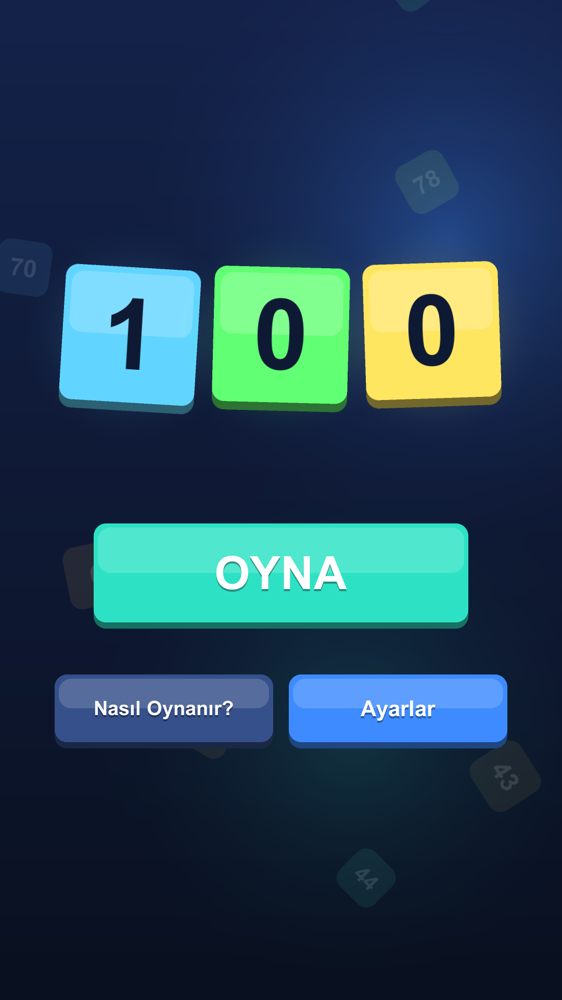
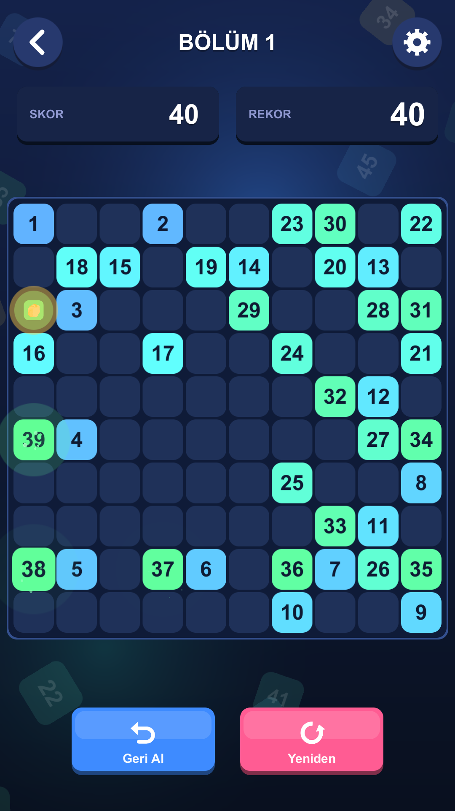
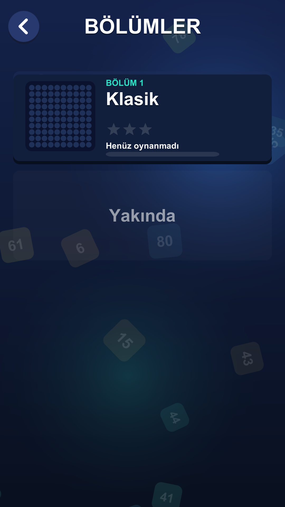
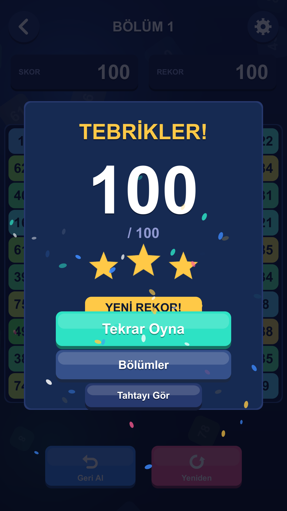
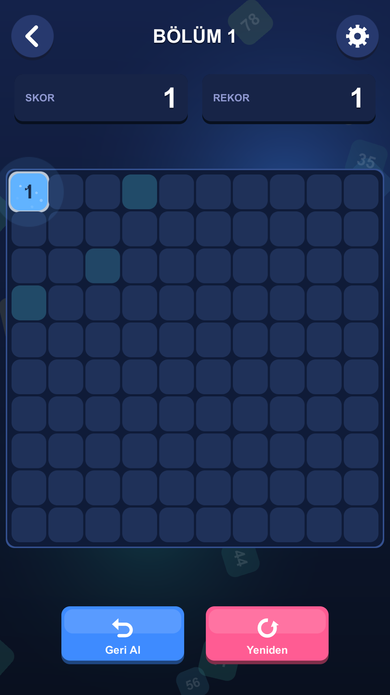

# 💯 100 (Hundred Game)

[🇹🇷 Türkçe](README.tr.md) | **🇬🇧 English**

**A modern, animated number-placement puzzle for mobile.** Fill a 10 × 10 grid with the numbers 1 to 100 in order. Sounds easy, but every number has to jump to a very specific square, and one wrong turn leaves you stuck. How far can you get?

   

<p align="center">
  
  
  
  
</p>

> **Note:** the in-game UI is **Turkish** only. Code and documentation are in English / Turkish.

## How to play

1. Place **1** on any square.
2. Place **2**, **3**, **4**... in order. From the square holding the last number, the next number must go to an **empty** square that is:
   - **3 squares away horizontally or vertically** (two empty squares in between), or
   - **2 squares away diagonally** (one empty square in between).
3. The squares you can use glow, so you always see your options.
4. When there are no moves left the game ends. **Your score is the last number you placed.** Reach 100 to win!

Stuck? Use **Undo** to take moves back, or **Restart**.

## Features

- **Level select with every level open**, each card shows your best score, stars and a mini-board that fills up with your progress. Unfinished games are saved and can be resumed.
- **Score system:** current score, best score and 1-3 stars per level.
- **Glowing legal moves**.
- **Undo, Restart** and automatic saving after every move.
- **Juicy animations:** pop-in cells, ripples and particle bursts, gold bursts every 10 numbers, shake on invalid taps, animated score count-up, confetti on victory, animated gradient background with floating number tiles.
- **Procedural audio, no audio files:** each number plays a note of a pentatonic scale, so counting up becomes a melody. Jingles, stars, errors and a calm ambient loop are synthesized at startup. Drop your own clips into `Resources/Audio/<SfxName>` to override them.
- **Mobile ready:** portrait layout, safe-area support, haptics, back button support, settings (sound, music, vibration), how-to-play screen with a visual diagram.
- Everything is built in code (generated sprites and icons), so the project needs **no third-party assets**.

## Screenshots

| Menu | Levels | Start | Gameplay |
|---|---|---|---|
|  |  |  |  |

| How to play | Settings | Victory |
|---|---|---|
|  |  |  |

## Setup

1. Install **Unity 6000.6** (or newer 6.x).
2. Clone the repo and open the folder in Unity Hub.
3. Run **HundredGame > Setup Project** (creates the scene, player settings and app icon). A ready-made `Assets/_Game/Scenes/Main.unity` is already included.
4. Press Play. The scene only holds a camera and `GameBootstrap`; the whole UI is built at runtime.

Build for Android / iOS from **File > Build Profiles** (portrait is already configured).

## Project structure

```
Assets/_Game/Scripts
├─ Core    GameBootstrap, Anim (tween runner), editor smoke bot
├─ Data    LevelDef + Levels, SaveData
├─ Game    Board (pure rules, no Unity types)
├─ UI      UIManager, UIKit, UIFx, MenuPages, GamePage, Popup
├─ Audio   Synth (procedural sounds), AudioManager
└─ Editor  HundredSetup, SmokeLauncher
```

## Adding a new level

Levels are plain data. Add an entry to `Levels.All` in `Assets/_Game/Scripts/Data/LevelDef.cs`:

```csharp
new LevelDef { Name = "Cross", Subtitle = "10 × 10 with holes", Size = 10,
               Blocked = new[] { 44, 45, 54, 55 }, StarScores = new[] { 30, 60, 96 } },
```

The level select, save data, stars and result screens pick it up automatically. `Blocked` lists cells (`y * Size + x`) that cannot be used.

## Test tools

- **HundredGame > Simulate Board** checks the move rules and plays bot games headlessly.
- **HundredGame > Run Smoke Test** walks through every screen, plays a full game with a bot and saves screenshots to `Logs/Smoke`.

## License

[MIT](LICENSE), (c) Berkay Tonga. No third-party assets or audio are used.
