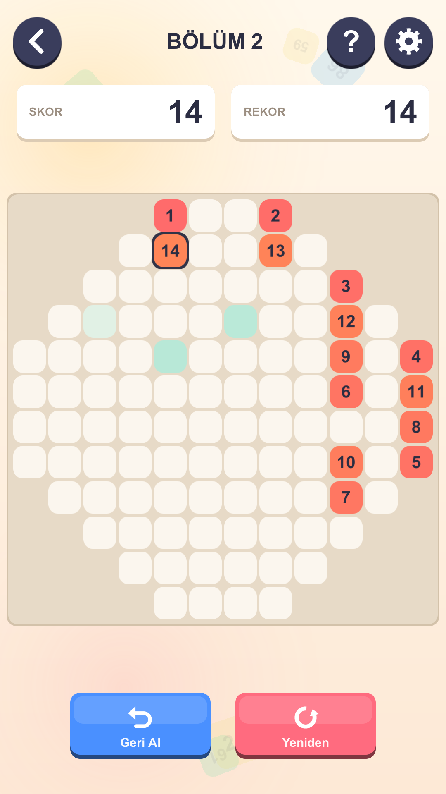
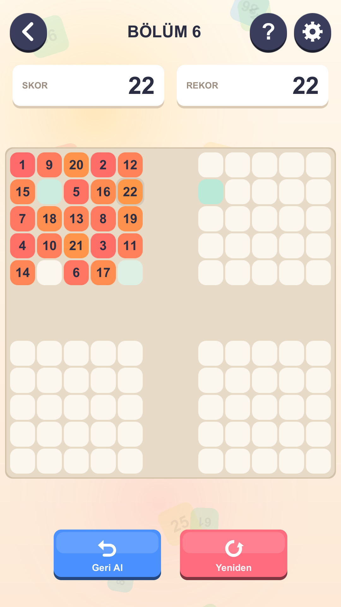
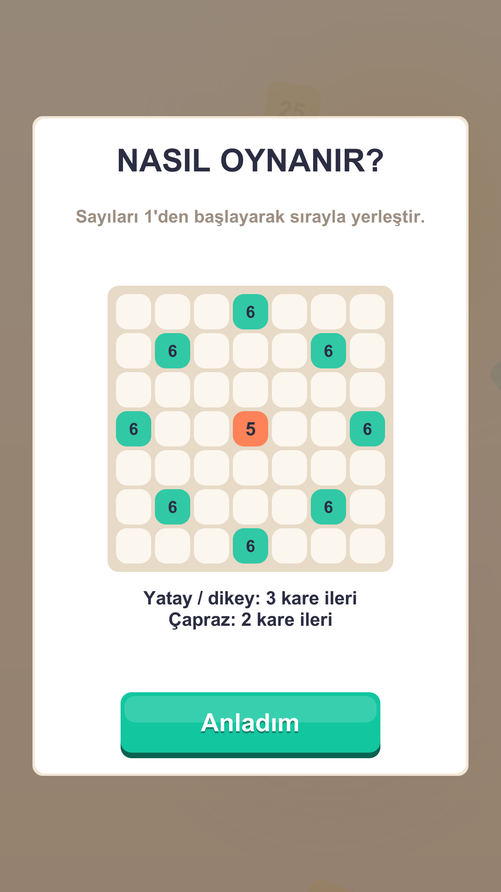
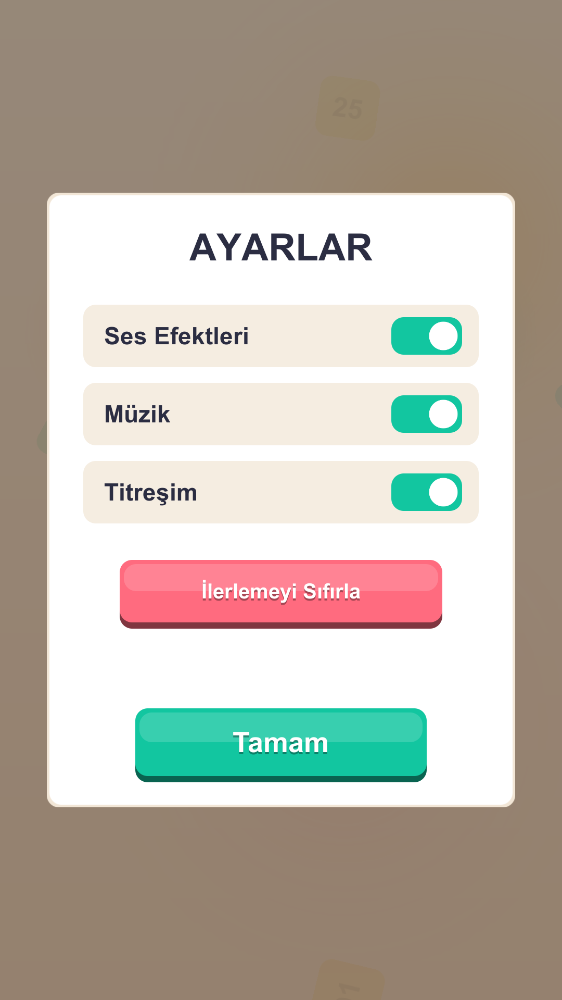

# 💯 100 (Hundred Game)

[🇹🇷 Türkçe](README.tr.md) | **🇬🇧 English**

**A modern, animated number-placement puzzle for mobile.** Fill the board with the numbers 1 to 100 in order. Sounds easy, but every number has to jump to a very specific square, and one wrong turn leaves you stuck. Six variations: classic, diamond, wrap-around, knight, ring and islands.

    

<p align="center">
  
  
  
  
</p>

> **Note:** the in-game UI is **Turkish** only. Code and documentation are in English / Turkish.

## How to play

1. Place **1** on any square.
2. Place **2**, **3**, **4**... in order. The next number must go to an **empty** square reachable from the last number by the level's jump rule. In the classic level that is:
   - **3 squares away horizontally or vertically** (two empty squares in between), or
   - **2 squares away diagonally** (one empty square in between).
3. The squares you can use softly glow.
4. When there are no moves left the game ends. **Your score is the last number you placed.** Fill every square to win!

Stuck? **Undo** takes moves back, **Restart** starts over. Both are also offered on the "no moves left" screen.

## Levels

| # | Name | Board | Rule |
|---|---|---|---|
| 1 | **Classic** | 10 × 10 flat | 3 straight or 2 diagonal |
| 2 | **Diamond** | 12 × 12 cut into a diamond (104 squares) | classic jumps |
| 3 | **Wrap** | 10 × 10, edges connected | classic jumps that continue on the opposite side |
| 4 | **Knight** | 10 × 10 flat | chess-knight jumps |
| 5 | **Ring** | 11 × 11 with a hole (96 squares) | classic jumps over the empty middle |
| 6 | **Islands** | four 5 × 5 islands (100 squares) | classic jumps; cross the water with a 3-square straight jump |

All levels are open from the start. A short rules popup (with a diagram) shows the first time you open a level.

## Features

- **Level select with every level open**, each card shows a mini-board that fills up with your best score, your stars and your record. Unfinished games are saved and can be resumed.
- **Score system:** current score, record and 1-3 stars per level (40% / 70% / 100% of the squares).
- **Soft glowing legal moves**, no clutter: just two cards, the board and two buttons.
- **Smooth animations:** pop-in cells, ripples and particle bursts, shake on invalid taps, animated score count-up, confetti on victory, calm animated background.
- **Procedural audio, no audio files:** each number plays a note of a pentatonic scale, so counting up becomes a melody. Effects and a calm ambient loop are synthesized at startup. Drop your own clips into `Resources/Audio/<SfxName>` to override them.
- **Mobile ready:** portrait layout, safe-area support, haptics, back button support, settings (sound, music, vibration).
- Everything is built in code (generated sprites and icons), so the project needs **no third-party assets**.

## Screenshots

| Menu | Levels | Diamond | Islands |
|---|---|---|---|
|  |  |  |  |

| How to play | No moves left | Victory | Settings |
|---|---|---|---|
|  |  |  |  |

## Setup

1. Install **Unity 6000.6** (or newer 6.x).
2. Clone the repo and open the folder in Unity Hub.
3. Run **HundredGame > Setup Project** (creates the scene, URP settings, player settings and app icon). A ready-made `Assets/_Game/Scenes/Main.unity` is already included.
4. Press Play. The scene only holds a camera and `GameBootstrap`; the whole UI is built at runtime.

Build for Android / iOS from **File > Build Profiles** (portrait is already configured).

## Project structure

```
Assets/_Game/Scripts
├─ Core    GameBootstrap, Anim (tween runner), editor smoke bot
├─ Data    LevelDef + Levels (all variations), SaveData
├─ Game    Board (pure rules, no Unity types)
├─ UI      UIManager, UIKit, UIFx, BoardLayout, MenuPages, GamePage, Popup
├─ Audio   Synth (procedural sounds), AudioManager
└─ Editor  HundredSetup, SmokeLauncher
```

## Adding a new level

Levels are plain data. Add an entry to `Levels.All` in `Assets/_Game/Scripts/Data/LevelDef.cs`:

```csharp
new LevelDef
{
    Name = "Hole", Subtitle = "9 × 9 with a hole", Rule = "Classic jumps over the hole.",
    SX = 9, SY = 9,                            // width, height (SZ adds floors for 3D)
    Offsets = Offsets.Build(3, 2, false),      // straight 3, diagonal 2
    Blocked = Levels.CenterHole(9, 3),         // optional: WrapX / WrapY, StarScores
},
```

The level select, save data, stars, rules popup and board drawing pick it up automatically. Not every rule set can be completed: some jump patterns split the board into two unreachable halves, so check a new level with a bot first (`Board.Hint` is a Warnsdorff-style bot, see **HundredGame > Simulate Board**).

## Test tools

- **HundredGame > Simulate Board** checks the move rules and plays bot games headlessly.
- **HundredGame > Run Smoke Test** walks through the screens, plays full games with a bot and saves screenshots to `Logs/Smoke`.

## License

[MIT](LICENSE), (c) Berkay Tonga. No third-party assets or audio are used.
