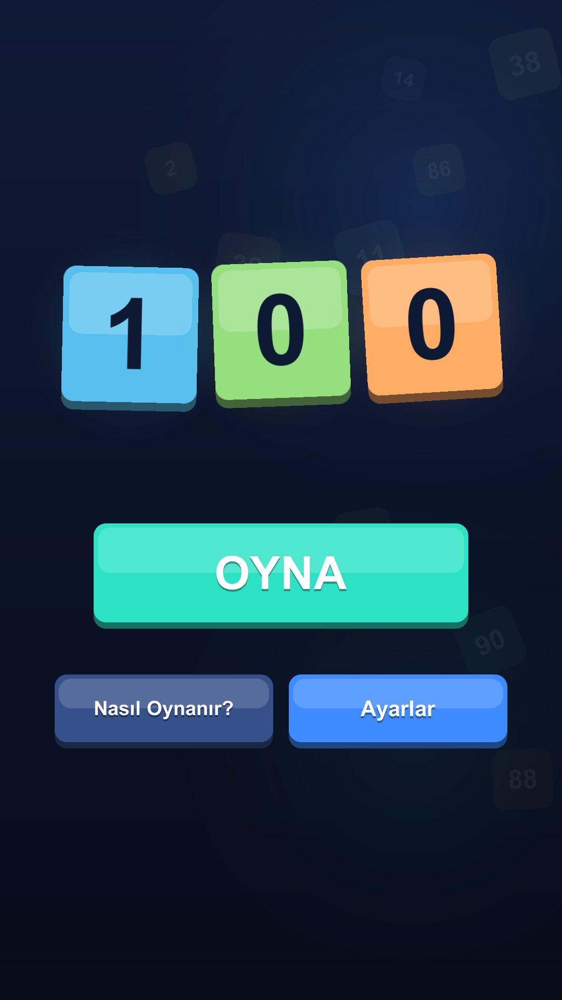
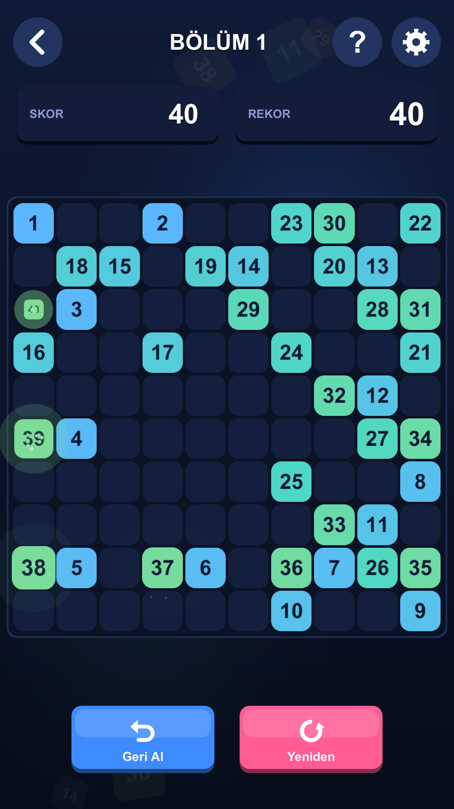
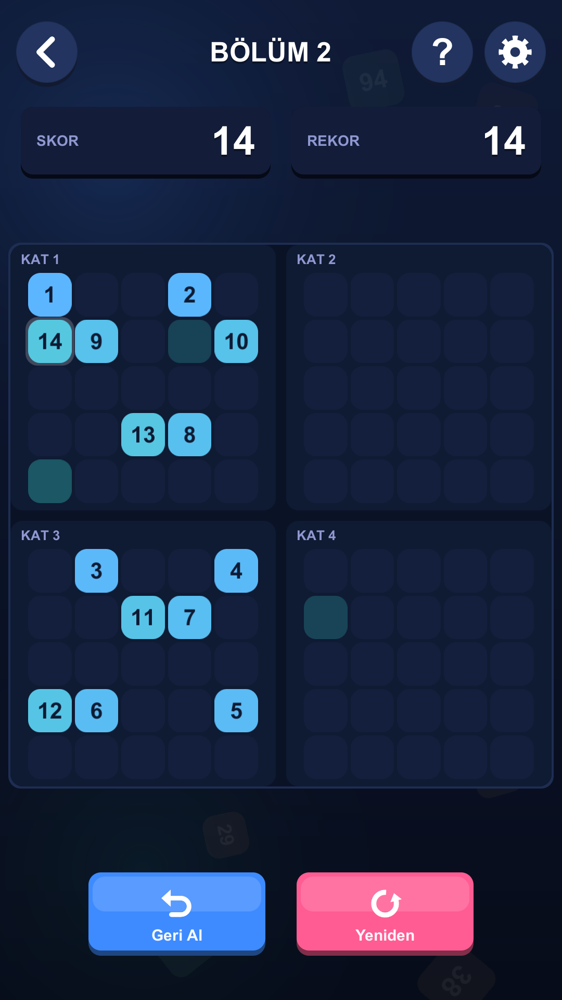
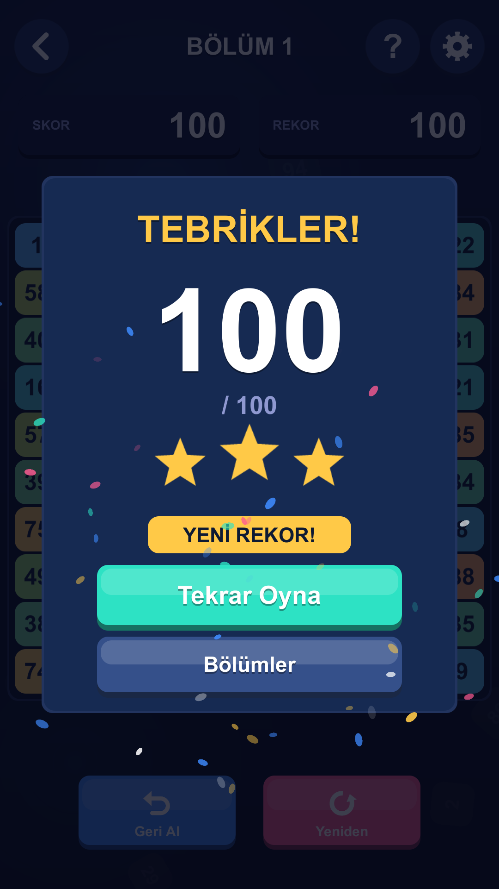
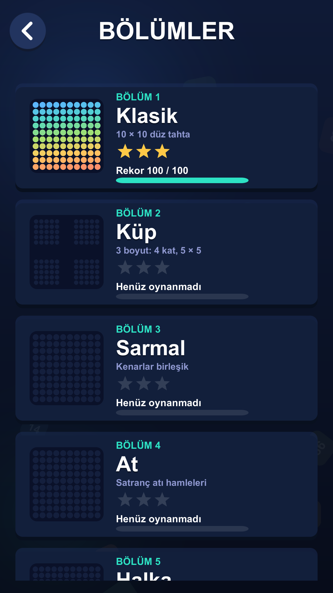
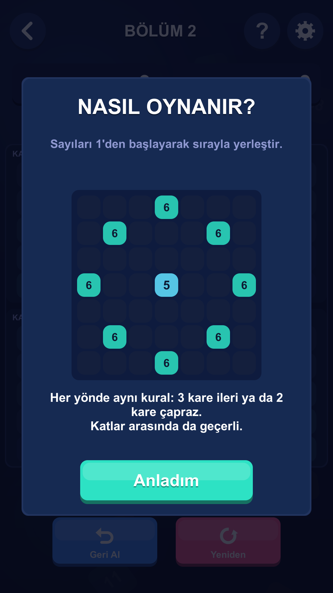
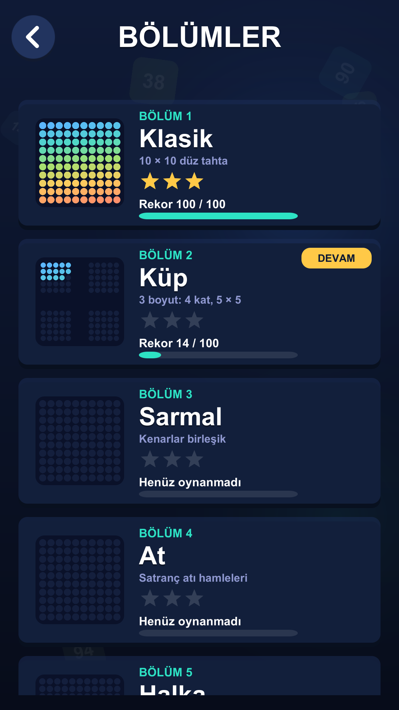
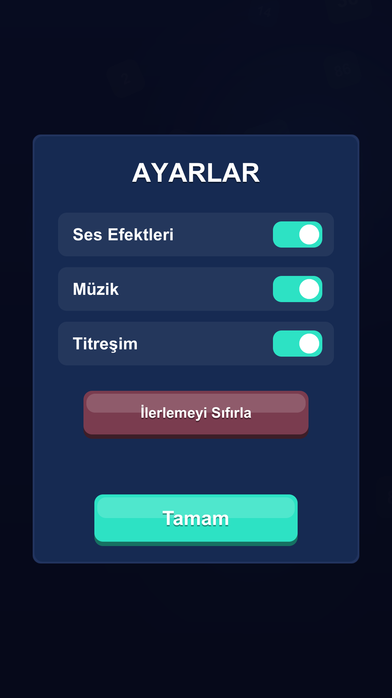

# 💯 100 (Hundred Game)

**🇹🇷 Türkçe** | [🇬🇧 English](README.md)

**Mobil için modern, animasyonlu sayı yerleştirme bulmacası.** Tahtayı 1'den 100'e kadar sırayla sayılarla doldur. Kulağa kolay geliyor, ama her sayı belirli bir kareye atlamak zorunda ve tek bir yanlış hamle seni sıkıştırır. Düz 10 × 10 tahtadan 3 boyutlu küpe kadar beş farklı varyasyon.

    

<p align="center">
  
  
  
  
</p>

## Nasıl oynanır?

1. **1** sayısını istediğin kareye koy.
2. Sırayla **2**, **3**, **4**... koy. Sıradaki sayı, son sayıdan bölümün atlama kuralıyla ulaşılabilen **boş** bir kareye gitmeli. Klasik bölümde bu:
   - **Yatay veya dikey 3 kare ileri** (arada 2 boş kare), ya da
   - **Çapraz 2 kare ileri** (arada 1 boş kare).
3. Gidebileceğin kareler hafifçe parlar.
4. Hamle kalmayınca oyun biter. **Skorun, koyduğun son sayıdır.** Tüm kareleri doldurursan kazanırsın!

Sıkıştın mı? **Geri Al** hamleleri geri alır, **Yeniden** baştan başlatır. İkisi de "hamle kalmadı" ekranında da var.

## Bölümler

| # | Ad | Tahta | Kural |
|---|---|---|---|
| 1 | **Klasik** | 10 × 10 düz | 3 düz veya 2 çapraz |
| 2 | **Küp** | 3 boyutlu, 5 × 5'lik 4 kat (100 kare) | her yönde aynı atlama, katlar dahil |
| 3 | **Sarmal** | 10 × 10, kenarlar birleşik | klasik atlama, taşan hamle karşı taraftan devam eder |
| 4 | **At** | 10 × 10 düz | satranç atı hamleleri |
| 5 | **Halka** | Ortası boş 11 × 11 (96 kare) | klasik atlama, ortadaki boşluğun üstünden |

Tüm bölümler baştan açık. Bir bölümü ilk açtığında şemalı kısa bir kural penceresi çıkar.

## Özellikler

- **Tüm bölümler açık** bölüm seçimi; her kartta rekorunla dolan mini tahta, yıldızlar ve rekor görünür. Yarım kalan oyunlar kaydedilir ve devam edilir.
- **Skor sistemi:** anlık skor, rekor ve bölüm başına 1-3 yıldız (karelerin %40 / %70 / %100'ü).
- **Hafif parlayan geçerli kareler**, kalabalık yok: iki kart, tahta ve iki buton.
- **3 boyutlu bölümler** ayrı katlar olarak çizilir, böylece kareler büyük ve rahat dokunulur kalır.
- **Akıcı animasyonlar:** beliren kareler, dalga ve parçacık efektleri, hatalı dokunuşta sarsıntı, sayılan skor, zafer konfetisi, sakin animasyonlu arka plan.
- **Ses dosyası yok, hepsi kodla üretilir:** her sayı pentatonik bir nota çalar, saymak melodiye dönüşür. Efektler ve sakin bir fon müziği açılışta sentezlenir. Kendi seslerini `Resources/Audio/<SesAdı>` içine koyarak değiştirebilirsin.
- **Mobile hazır:** dikey ekran, güvenli alan desteği, titreşim, geri tuşu, ayarlar (ses, müzik, titreşim).
- Her şey kodla üretilir (sprite ve ikonlar dahil), **üçüncü taraf asset gerekmez**.

## Ekran görüntüleri

| Menü | Bölümler | Klasik | Küp |
|---|---|---|---|
|  |  |  |  |

| Nasıl Oynanır | Hamle kalmadı | Zafer | Ayarlar |
|---|---|---|---|
|  |  |  |  |

## Kurulum

1. **Unity 6000.6** (veya daha yeni 6.x) kur.
2. Depoyu klonla, Unity Hub ile klasörü aç.
3. **HundredGame > Setup Project** menüsünü çalıştır (sahne, URP, oyuncu ayarları ve ikon oluşturulur). Hazır `Assets/_Game/Scenes/Main.unity` zaten depoda var.
4. Play'e bas. Sahnede sadece kamera ve `GameBootstrap` vardır; tüm arayüz çalışma anında kurulur.

Android / iOS derlemesi için **File > Build Profiles** kullan (dikey ekran ayarlı).

## Proje yapısı

```
Assets/_Game/Scripts
├─ Core    GameBootstrap, Anim (tween), editör smoke botu
├─ Data    LevelDef + Levels (tüm varyasyonlar), SaveData
├─ Game    Board (saf kural mantığı)
├─ UI      UIManager, UIKit, UIFx, BoardLayout, MenuPages, GamePage, Popup
├─ Audio   Synth (kodla ses üretimi), AudioManager
└─ Editor  HundredSetup, SmokeLauncher
```

## Yeni bölüm ekleme

Bölümler düz veridir. `Assets/_Game/Scripts/Data/LevelDef.cs` içindeki `Levels.All` listesine ekle:

```csharp
new LevelDef
{
    Name = "Kule", Subtitle = "3 boyut, 3 kat", Rule = "Her yönde aynı atlama.",
    SX = 6, SY = 6, SZ = 3,                    // genişlik, yükseklik, kat sayısı
    Offsets = Offsets.Build(3, 2, true),       // düz 3, çapraz 2, 3 boyutlu
    // WrapX = true, Blocked = Levels.CenterHole(6, 2), StarScores = new[] { 30, 60, 108 },
},
```

Bölüm seçimi, kayıt, yıldızlar, kural penceresi ve tahta çizimi (katlar dahil) otomatik algılar. Her kural seti tamamlanamaz: bazı atlama düzenleri tahtayı ulaşılamaz iki yarıya böler. Yeni bir bölümü önce botla dene (`Board.Hint` Warnsdorff tarzı bir bottur, **HundredGame > Simulate Board**).

## Test araçları

- **HundredGame > Simulate Board:** hamle kurallarını doğrular, botlarla oyun oynatır.
- **HundredGame > Run Smoke Test:** ekranları gezer, botla tam oyunlar oynar ve `Logs/Smoke` içine ekran görüntüsü alır.

## Lisans

[MIT](LICENSE), (c) Berkay Tonga. Üçüncü taraf asset veya ses kullanılmamıştır.
